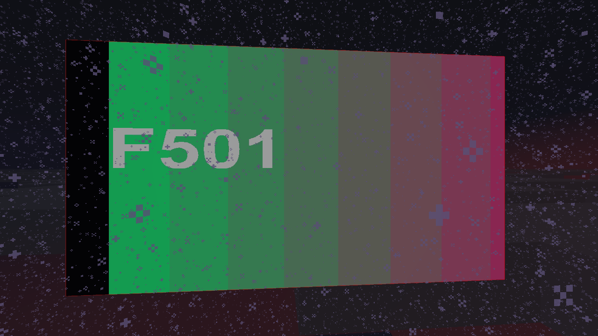
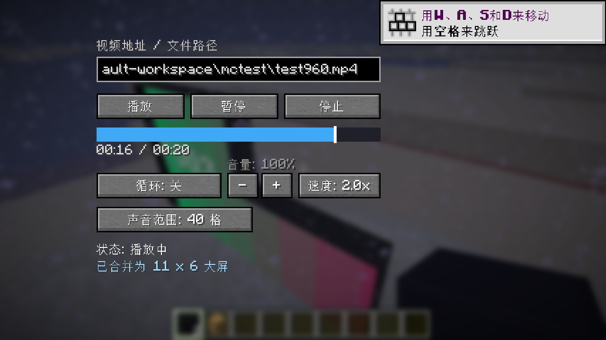
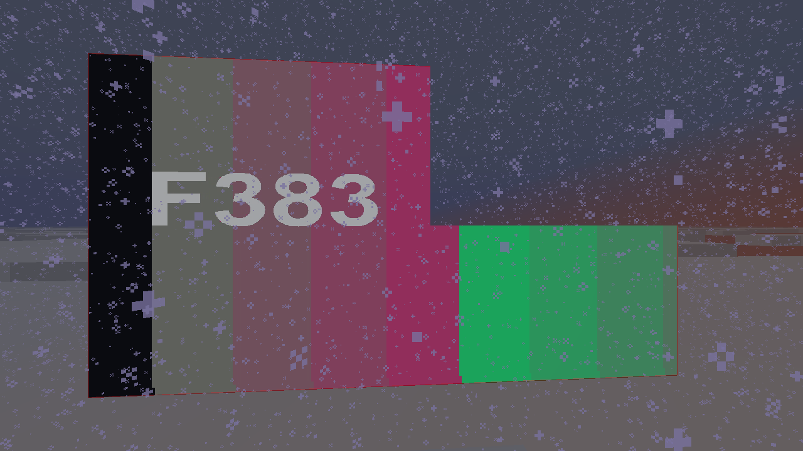
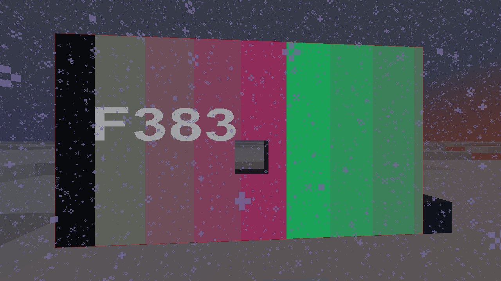
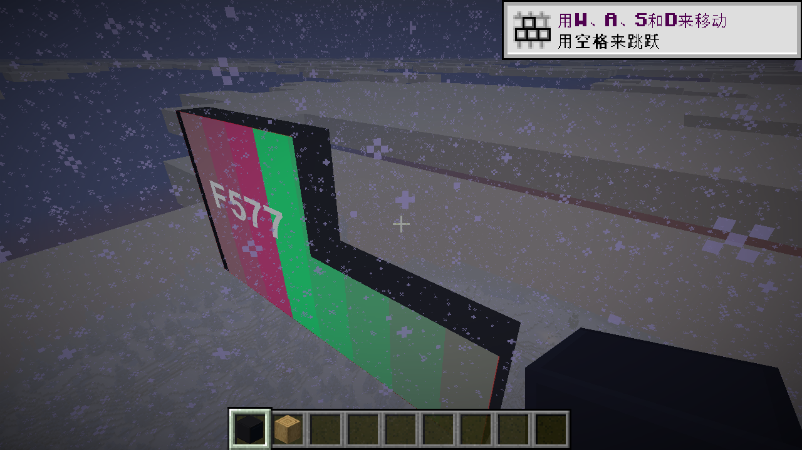

# VPlayer

在 Minecraft 里放一块能播放视频的屏幕：支持视频直链 / 本地文件，多个屏幕方块自动拼成一整块大屏，
自带播放控制界面与独立音频输出。

> 支持 **NeoForge 与 Forge** 两条线，横跨 **Minecraft 1.20.1 / 1.21.1 / 1.21.11**。



## 功能

- **视频播放**：HTTP(S) 直链（B 站 CDN 直链会自动带 Referer / User-Agent）或本地视频文件
- **播放控制界面**：进度条拖动、播放 / 暂停 / 停止、±10 秒、音量、倍速（0.5x~2x）、循环开关
- **多方块大屏**：同朝向相邻的屏幕方块自动合并成一整块大屏，画面跨方块连续显示
- **任意形状**：L 形、带缺口等不规则屏幕也支持；画面严格只显示在方块上，缺格透空，
  多放的单格不会把画面拉长；补全整行/整列即可扩大屏幕
- **独立音频**：每块大屏一个声音范围（默认 40 格、上限 64 格），按与玩家的距离淡出
- **完整方块造型**：正面是屏幕，外缘/侧面是边框，无光照夜晚也亮；物品图标是 3D 方块造型
- **暂停原地续播**：暂停后再播放，不重新加载、不快进跳变
- **大屏结构变化**：播放会话自动迁移到新主屏，不中断
- **合成与掉落**：四角平滑石头 + 上中红石 + 下中红石灯 + 中间红绿蓝玻璃板，一次 4 个；
  挖掉方块掉回屏幕物品

## 截图

| | |
| --- | --- |
|  |  |
|  |  |
|  | |

## 版本表

| 目录 | Minecraft | 加载器 | JDK | 状态 |
| --- | --- | --- | --- | --- |
| [`neoforge/1.20.1`](neoforge/1.20.1) | 1.20.1 | NeoForge 47.1.106 | 17 | ✅ 已实机验证 |
| [`neoforge/1.21.1`](neoforge/1.21.1) | 1.21.1 | NeoForge 21.1.265 | 21 | ✅ 已实机验证 |
| [`neoforge/1.21.11`](neoforge/1.21.11) | 1.21.11 | NeoForge 21.11.48 | 21 | ✅ 已实机验证 |
| [`forge/1.20.1`](forge/1.20.1) | 1.20.1 | Forge 47.4.28 | 17 | ✅ 已实机验证 |
| [`forge/1.21.1`](forge/1.21.1) | 1.21.1 | Forge 52.1.21 | 21 | ✅ 已实机验证 |
| [`forge/1.21.11`](forge/1.21.11) | 1.21.11 | Forge 61.2.5 | 21 | ✅ 已实机验证 |

每个版本目录里都有该版本单独的 **构建说明**（`构建说明*.md`），包含依赖版本、构建命令、
已知坑与自检方法。

## 构建

进入任一版本目录，用 Java 21（1.20.1 版本用 Java 17）：

```powershell
# NeoForge 版本
.\gradlew.bat build fatJar --no-daemon

# Forge 版本
.\gradlew.bat build fatJar --no-daemon
```

产物在 `build/libs/`：

- `vplayer-1.0.0.jar`：瘦 jar（只有模组自身代码/资源）
- `vplayer-1.0.0-all.jar`：**可分发成品**，内含 Windows 版 FFmpeg/JavaCV 原生库（约 122 MB），
  直接丢进 `mods/` 即可

> 各版本构建环境与坑见对应目录的构建说明，例如：
> - `forge/1.21.11`：ForgeGradle 7 + Gradle 9.5；构建工具链需要 **JDK 25**（Minecraft Mavenizer 要求），
>   游戏运行仍是 Java 21
> - `neoforge/1.21.11`：`maven.neoforged.net` 被 DNS 污染时，`build.gradle` 会自动改用官方 CDN 镜像
> - 国内网络：Gradle 依赖下载慢可自备镜像/代理，详见各构建说明

## 目录结构

```
neoforge/           NeoForge 版源码
  1.20.1/
  1.21.1/
  1.21.11/
forge/              Forge 版源码
  1.20.1/
  1.21.1/
  1.21.11/
screenshots/        README 截图
```

每个版本目录只包含：`src/`、`build.gradle`、`settings.gradle`、`gradle.properties`、
`gradlew`/`gradlew.bat`/`gradle/wrapper/`、`构建说明*.md`，不含 build 产物与缓存。

## 已知问题

- **准星靠近屏幕时画面会变暗**：已知渲染现象，暂未修复（所有版本相同）。
- 1.21.11 的 `GuiGraphics.drawString(..., int color)` 文字颜色必须带 alpha（`0xFFRRGGBB`），
  否则完全不渲染；Forge 1.21.11 版已修（见其构建说明）。
- 1.21.1 / 1.20.1 Forge 在部分环境（用自建启动脚本直接启动）下可能遇到 Forge 内部
  `LootModifierManager` 未初始化导致方块掉落崩溃；`forge/1.21.1` 带兼容修补，正常启动器一般不会触发。
- 停止/切换视频时日志会出现 `InterruptedException: sleep interrupted`，是既有正常日志，不是崩溃。

## 实现说明

- 视频解码/播放：**JavaCV + FFmpeg**（`org.bytedeco:javacv`），解码到动态纹理，按屏幕格子裁剪绘制
- 音频：`javax.sound.sampled` 直接输出 PCM（支持倍速重采样与音量/距离衰减）
- 渲染：1.20.1/1.21.1 用 `PoseStack` 直接绘制；**1.21.11 用新的 RenderState / `submitCustomGeometry` 渲染管线**
- 网络：NeoForge payload / Forge `SimpleChannel`（客户端控制 → 服务端广播状态）
- 原生库：模组启动时把 jar 内当前平台的 FFmpeg dll 解压到 `<gameDir>/vplayer-natives/` 再加载

## 许可

[MIT](LICENSE)

## 免责声明

本项目为独立开发的 Minecraft 模组，与 Mojang Studios / Microsoft 无关。
仓库中不包含 Minecraft、Forge、NeoForge 的代码；运行时依赖的 JavaCV / FFmpeg 等第三方库
遵循其各自的许可证（详见各版本 `build.gradle` 中的依赖与对应项目主页）。
